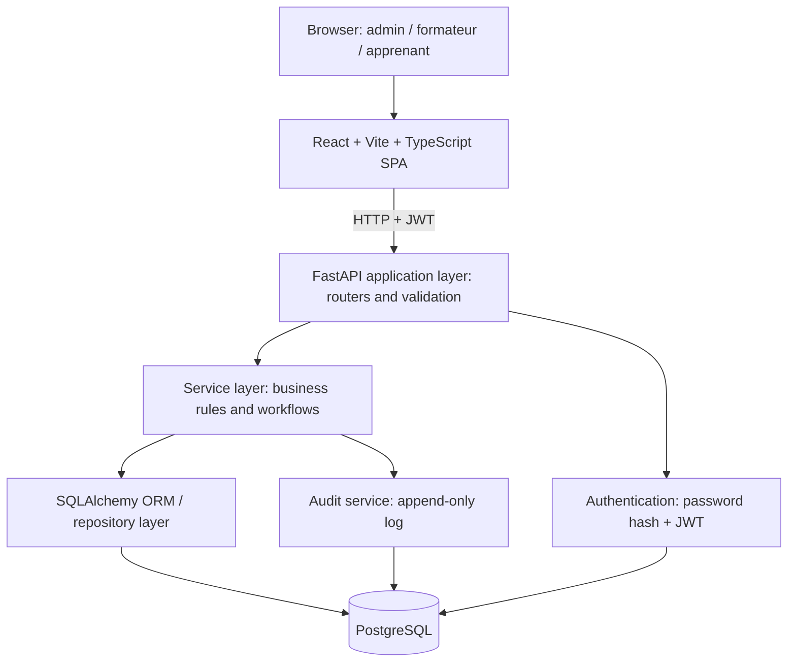
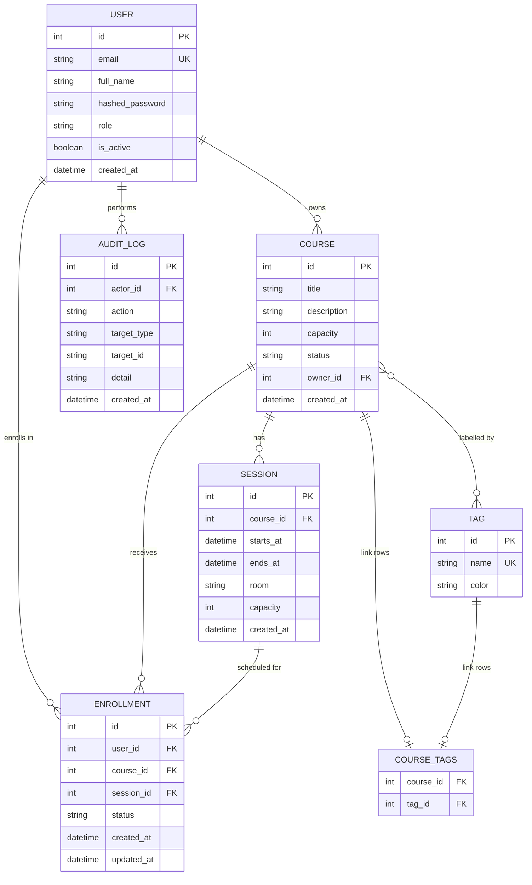
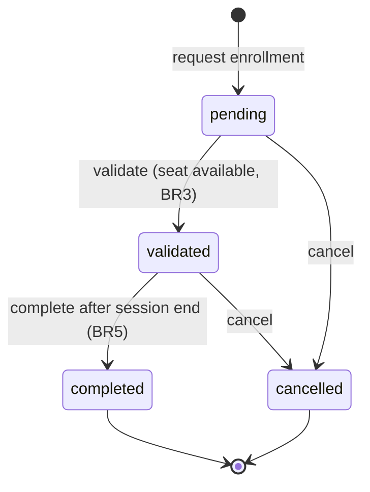

# EduFlow Design Document

## 1. Purpose and scope

This document describes the architecture, data model, API surface, role model,
business rules and security design of EduFlow. It is the design input for the
traceability matrix (`docs/traceability.md`) and the ISO/IEC 25010 conformance
report (`docs/iso25010-conformance.md`). It intentionally contains no test
results; results are recorded only after a real execution has produced
evidence.

## 2. Architecture

EduFlow uses a layered backend behind a single-page frontend. Each layer has one
responsibility and depends only on the layer below it, which supports the
maintainability and testability requirements.

Layer responsibilities:

- **Presentation** (React SPA): renders views, enforces client-side route
  guards, calls the REST API, stores the JWT.
- **Application / API** (FastAPI routers in `app/api.py`): Pydantic request
  validation, authentication and authorization dependencies, response models,
  HTTP status codes.
- **Service** (`app/services.py`): implements BR1..BR8, the enrollment workflow,
  dashboard aggregation and search. This is where unit tests focus.
- **Repository** (SQLAlchemy models in `app/models.py`): persistence only, no
  business decisions.
- **Data** (PostgreSQL): relational integrity enforced by constraints and
  foreign keys in addition to service rules.

Cross-cutting concerns: JWT authentication, role-based access control (RBAC),
audit logging, structured logging, and centralized error handling through
FastAPI exception handlers.

## 3. Data model

### 3.1 Entity relationship overview

### 3.2 Tables and columns

**users**

| Column | Type | Constraint / note |
| --- | --- | --- |
| id | INTEGER | primary key |
| email | VARCHAR(255) | unique, indexed, not null (BR1) |
| full_name | VARCHAR(120) | not null |
| hashed_password | VARCHAR(100) | hash only, never plaintext (BR8) |
| role | VARCHAR(20) | admin / formateur / apprenant, default apprenant |
| is_active | BOOLEAN | default true |
| created_at | DATETIME | default now |

**courses**

| Column | Type | Constraint / note |
| --- | --- | --- |
| id | INTEGER | primary key |
| title | VARCHAR(160) | indexed, not null |
| description | TEXT | default empty |
| capacity | INTEGER | default 20, used by BR3 |
| status | VARCHAR(20) | draft / published, default draft |
| owner_id | INTEGER | foreign key to users.id, indexed (formateur owner) |
| created_at | DATETIME | default now |

**sessions**

| Column | Type | Constraint / note |
| --- | --- | --- |
| id | INTEGER | primary key |
| course_id | INTEGER | foreign key to courses.id, ON DELETE CASCADE, indexed (1-N) |
| starts_at | DATETIME | not null |
| ends_at | DATETIME | not null, used by BR5 |
| room | VARCHAR(60) | default empty |
| capacity | INTEGER | default 20 |
| created_at | DATETIME | default now |

**enrollments**

| Column | Type | Constraint / note |
| --- | --- | --- |
| id | INTEGER | primary key |
| user_id | INTEGER | foreign key to users.id, indexed |
| course_id | INTEGER | foreign key to courses.id, indexed |
| session_id | INTEGER | foreign key to sessions.id, nullable, indexed |
| status | VARCHAR(20) | pending / validated / completed / cancelled, indexed |
| created_at | DATETIME | indexed, default now |
| updated_at | DATETIME | default now, updated on write |

Unique constraint `uq_user_course` on `(user_id, course_id)` (BR2).

**tags**

| Column | Type | Constraint / note |
| --- | --- | --- |
| id | INTEGER | primary key |
| name | VARCHAR(60) | unique, indexed, not null |
| color | VARCHAR(20) | nullable |

**course_tags** (association table for the N-N relation)

| Column | Type | Constraint / note |
| --- | --- | --- |
| course_id | INTEGER | foreign key to courses.id, part of composite primary key |
| tag_id | INTEGER | foreign key to tags.id, part of composite primary key |

**audit_logs** (append-only)

| Column | Type | Constraint / note |
| --- | --- | --- |
| id | INTEGER | primary key |
| actor_id | INTEGER | foreign key to users.id, nullable, indexed |
| action | VARCHAR(80) | indexed, e.g. `login.failed`, `enrollment.validated` |
| target_type | VARCHAR(40) | entity name |
| target_id | VARCHAR(40) | nullable identifier of the affected entity |
| detail | TEXT | structured context, never passwords or tokens |
| created_at | DATETIME | indexed, default now |

No update or delete endpoint is exposed for audit logs (BR7).

### 3.3 Relationships summary

- `users` 1-N `courses` via `courses.owner_id` (a formateur owns courses).
- `courses` 1-N `sessions` via `sessions.course_id` (cascade delete on sessions).
- `users` 1-N `enrollments` and `courses` 1-N `enrollments` (two 1-N sides).
- `sessions` 0/1-N `enrollments` via the nullable `enrollments.session_id`.
- `courses` N-N `tags` via `course_tags`.
- `users` 1-N `audit_logs`.

## 4. API endpoints

Endpoints live in `app/api.py` under the `/api/v1` prefix; the health check is at
`/health`. Authentication uses a bearer JWT except where noted. The API
contract is exercised by API tests (see `docs/traceability.md`, FR2/FR3).

**Authentication**

| Method | Path | Description | Auth |
| --- | --- | --- | --- |
| POST | /api/v1/auth/login | Issue a JWT on valid credentials | no |
| GET | /api/v1/auth/me | Current user profile | yes |

**Users**

| Method | Path | Description |
| --- | --- | --- |
| GET | /api/v1/users | List users, paginated (admin) |
| POST | /api/v1/users | Create a user (admin) |
| GET | /api/v1/users/{user_id} | Read a user |
| PATCH | /api/v1/users/{user_id} | Update a user |
| DELETE | /api/v1/users/{user_id} | Deactivate / delete a user |

**Courses**

| Method | Path | Description |
| --- | --- | --- |
| GET | /api/v1/courses | List courses, paginated and filterable |
| POST | /api/v1/courses | Create a course |
| GET | /api/v1/courses/{course_id} | Read a course with sessions and tags |
| PATCH | /api/v1/courses/{course_id} | Update a course |
| DELETE | /api/v1/courses/{course_id} | Delete a course (guarded by BR6) |

**Sessions**

| Method | Path | Description |
| --- | --- | --- |
| GET | /api/v1/sessions | List sessions, filterable by course |
| POST | /api/v1/sessions | Create a session |
| PATCH | /api/v1/sessions/{session_id} | Update a session |
| DELETE | /api/v1/sessions/{session_id} | Delete a session |

**Enrollments and workflow**

| Method | Path | Description |
| --- | --- | --- |
| GET | /api/v1/enrollments | List / search / filter enrollments, paginated (FR5) |
| POST | /api/v1/enrollments | Request enrollment (status = pending) |
| PATCH | /api/v1/enrollments/{enrollment_id}/status | Apply a workflow transition with `{"status": ...}` |
| DELETE | /api/v1/enrollments/{enrollment_id} | Cancel / remove an enrollment |

**Tags**

| Method | Path | Description |
| --- | --- | --- |
| GET | /api/v1/tags | List tags |
| POST | /api/v1/tags | Create a tag |
| DELETE | /api/v1/tags/{tag_id} | Delete a tag |

Tag attachment to a course is performed through the `tag_ids` field accepted by
the course create/update endpoints.

**Dashboard and audit**

| Method | Path | Description |
| --- | --- | --- |
| GET | /api/v1/dashboard | Aggregated enrollment counts by status, occupancy and time indicators (FR4) |
| GET | /api/v1/audit | Query the audit log, paginated (read-only) |
| GET | /health | Liveness check |

List endpoints accept query filters (for example status, course, pagination)
and return a consistent paginated envelope.

## 5. Role matrix

`C` = create, `R` = read, `U` = update, `D` = delete. Ownership means the
formateur must own the course.

| Resource / action | admin | formateur | apprenant |
| --- | --- | --- | --- |
| Users: list / manage | C R U D | R (own) | R (own) |
| Courses: create | yes | yes | no |
| Courses: read | yes | yes | yes |
| Courses: update / delete | yes | yes (owned) | no |
| Sessions: manage | yes | yes (owned course) | no |
| Sessions: read | yes | yes | yes |
| Enrollment: request | yes | yes | yes |
| Enrollment: read | all | own courses | own only (BR4) |
| Enrollment: status transition | yes | yes (owned course) | own cancel only |
| Enrollment: delete | yes | yes (owned course) | own (not validated) |
| Tags: manage | yes | yes | no |
| Dashboard: global | yes | scoped to owned courses | own data |
| Audit log: read | yes | no | no |

RBAC is enforced server-side in dependencies and service methods; the frontend
guards are a usability measure, not a security boundary.

## 6. Enrollment workflow

Transitions are applied through `PATCH /api/v1/enrollments/{id}/status`.
Allowed transitions are `pending -> {validated, cancelled}` and
`validated -> {completed, cancelled}`; `completed` and `cancelled` are terminal.
A learner may cancel only their own enrollment. Any other transition is
rejected and the state is left unchanged.

## 7. Business rules

| ID | Rule | Enforcement |
| --- | --- | --- |
| BR1 | Email addresses are unique across users. | DB unique constraint + service pre-check |
| BR2 | A user can enroll at most once per course. | Unique constraint `uq_user_course` |
| BR3 | Validation is refused when course capacity is reached. | Transactional validated-count vs capacity check |
| BR4 | A learner can read only their own enrollments; role ownership applies. | RBAC dependency + query filter |
| BR5 | Completion is allowed only after the related session has ended. | Service guard on the `completed` transition |
| BR6 | A course with validated enrollments cannot be deleted. | Delete guard returning HTTP 409 |
| BR7 | Every write and authentication event writes an append-only audit entry. | Audit service called in write/auth paths |
| BR8 | Passwords meet strength policy and JWTs are signed with a strong secret and short expiry. | Registration validator + signing config |

## 8. OWASP Top 10 (2025) mapping to design decisions

| OWASP 2025 category | Design decision |
| --- | --- |
| A01 Broken Access Control | Server-side RBAC in dependencies and services (Section 5), ownership checks (BR4), deny-by-default endpoints. |
| A02 Security Misconfiguration | Least-privilege container defaults, no debug mode in production, explicit CORS and security headers, documented config in `docs/install.md`. |
| A03 Software Supply Chain Failures | Pinned dependencies with a lockfile; pip-audit in CI (SCA) over `requirements.txt`. |
| A04 Cryptographic Failures | Password hashing with a slow salted algorithm (BR8), JWT signing with a strong secret, TLS termination in front of the API. |
| A05 Injection | SQLAlchemy ORM with parameterized queries only; Pydantic request validation; no string-built SQL or shell commands from input. |
| A06 Insecure Design | Explicit workflow and business rules (Sections 6-7), capacity check inside a transaction, separation of layers. |
| A07 Authentication Failures | Strong password policy, JWT expiry, audit of failed logins (BR7/BR8), rate limiting at the edge where available. |
| A08 Software and Data Integrity Failures | Signed JWTs, append-only audit log, integrity checks on CI artifacts, no deserialization of untrusted data. |
| A09 Security Logging and Alerting Failures | Structured audit of all sensitive actions and auth events with actor, action, target and time (BR7). |
| A10 Mishandling of Exceptional Conditions | Centralized exception handlers, generic client error messages, validator rejections logged without secrets. |

## 9. Stack justification

FastAPI and SQLAlchemy were chosen because they fit a typed, testable layered
backend: dependency injection makes RBAC and audit cross-cutting concerns easy
to unit test, and Pydantic validates input at the boundary. React with Vite and
TypeScript provides a typed SPA with fast builds, while PostgreSQL gives the
relational constraints the business rules rely on. Docker Compose makes the
whole environment reproducible (portability), and the Python-native test and
security tools (pytest, Bandit, pip-audit) cover the required ISO layers without
adding unrelated ecosystems.
